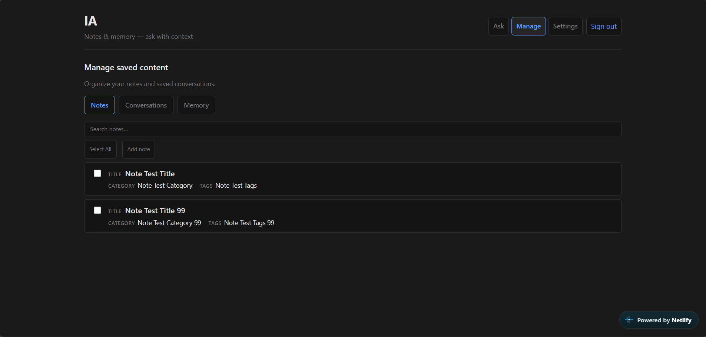
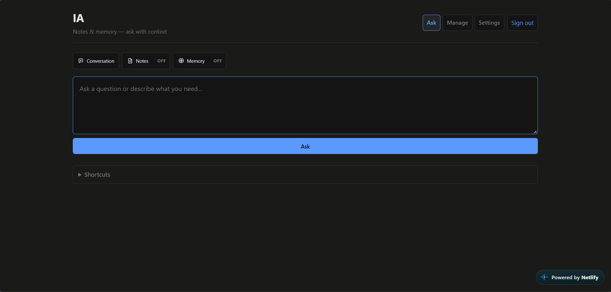
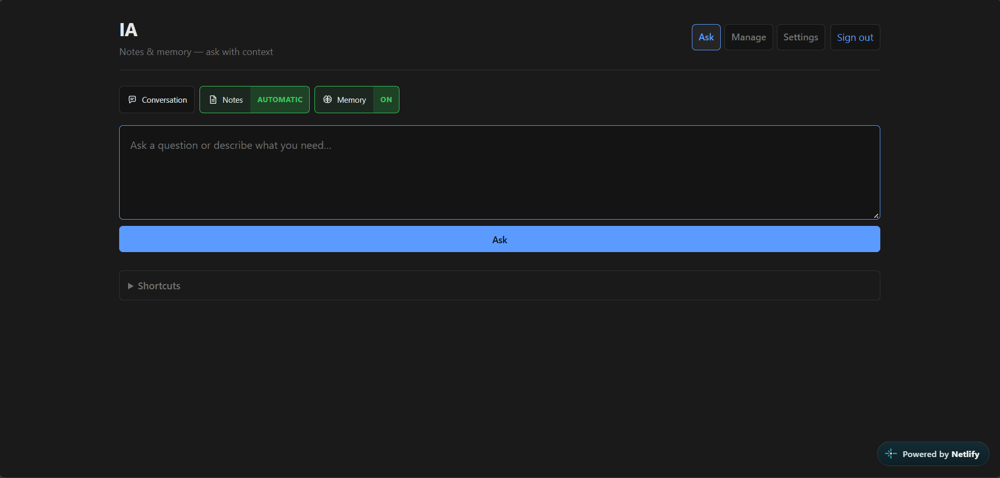
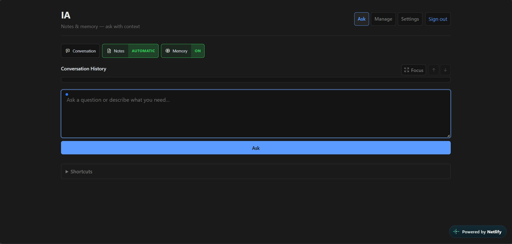
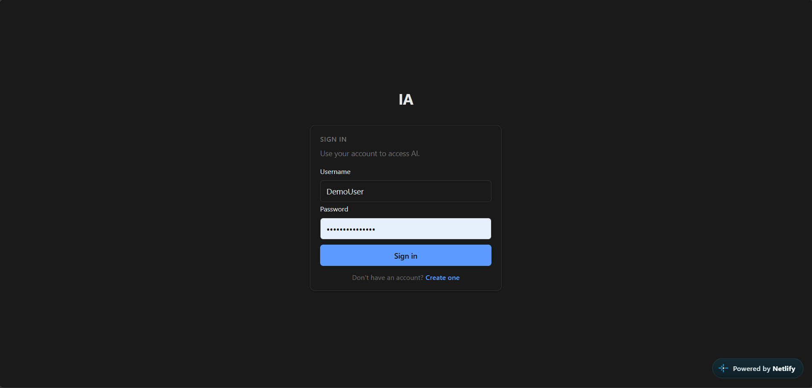
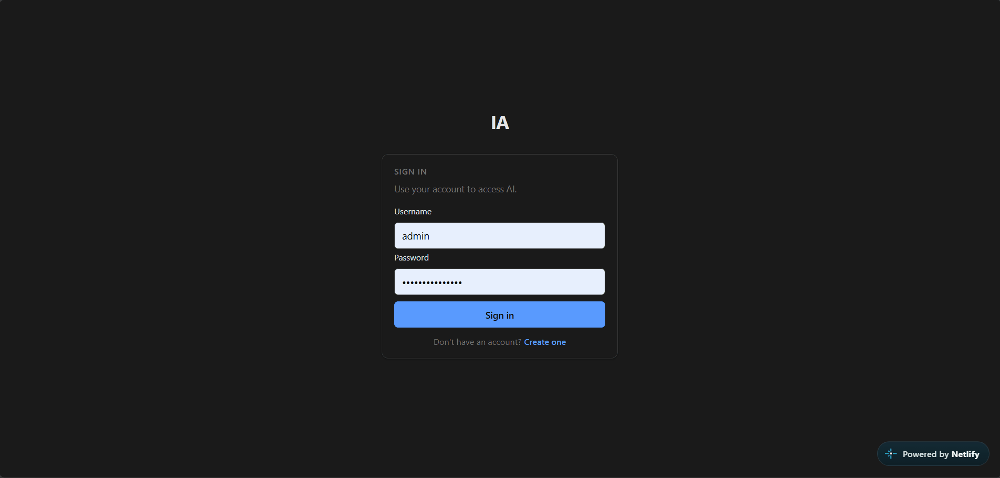
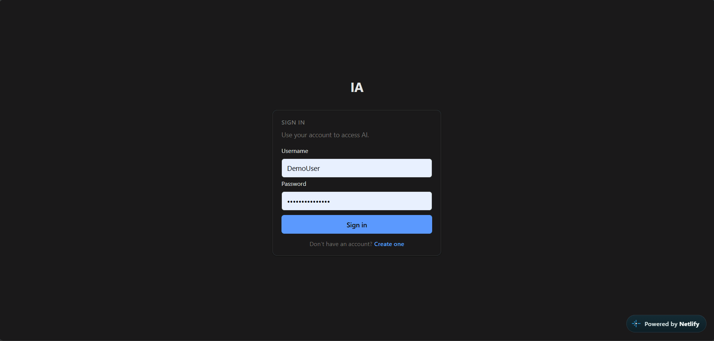
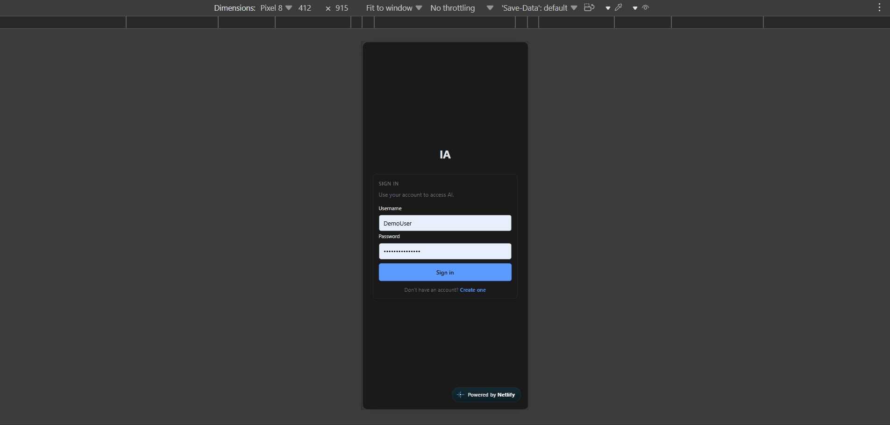

# IA

Personal notes + AI assistant. React 18, Flask, PostgreSQL, Groq LLM, FAISS.

**Live:** [https://ia-ai.netlify.app/login](https://ia-ai.netlify.app/login)

---

## Quick Demo

> Live: [https://ia-ai.netlify.app/login](https://ia-ai.netlify.app/login)

Full-stack notes + AI assistant. React 18, Flask, PostgreSQL, Groq LLM, FAISS.

**Features:**

- Notes (text, PDF, PPTX, screenshot OCR)
- Ask with notes/memory context, conversation history, `!remember`
- Flashcard generation from selected notes
- Persistent memory (save, edit, delete durable facts)
- Admin: users, diagnostics, credits
- AI suggestions overlay (content-free)

**Stack:** React 18 (Vite) · Flask (Python 3.10+) · PostgreSQL · Groq LLM · FAISS · JWT auth

---

## Demo

### Core features

| Feature | GIF | Steps |
|--------|-----|-------|
| **Notes CRUD** |  | Create, edit, filter by category/tag, import from PDF/PPTX/screenshots. |
| **Ask (Q&A)** |  | Ask with Notes/Memory context, conversation history, `!remember` command. |
| **Flashcards** |  | Select notes → generate deck → review/edit cards → save. |
| **Memory** |  | Save durable facts, edit/delete, toggle ON/OFF, lexical retrieval. |
| **Auth** |  | Register → Login → protected pages. |
| **Admin** |  | User management, diagnostics, credit tracking (role-gated). |
| **AI Suggestions** |  | Dismissable overlay with content-free action suggestions. |
| **Responsive UI** |  | Mobile-friendly across all pages. |

Full test checklist: [docs/testing.md](docs/testing.md)

---

## Quick start

**Prerequisites:** Python 3.10+, Node 18+, PostgreSQL

| Step | Action |
|------|--------|
| Setup | Copy [`.env.example`](.env.example) → `.env`; set `JWT_SECRET`, `DATABASE_URL`, `AI_KEY` |
| Database | Apply migrations from `backend/` (see [docs/setup.md](docs/setup.md)) |
| Frontend | `cd frontend` → `npm install` → `npm run build` |
| Backend | `cd backend` → `pip install -r requirements.txt` → `python run.py` |
| Test | `cd backend` → `python -m scripts.test.test_flashcards` (see [docs/testing.md](docs/testing.md)) |

Open **http://127.0.0.1:5000** — sign in or register.

---

## Features

- **Notes** — CRUD, categories, tags; import from PDF, PPTX, screenshots
- **Ask** — JWT Q&A with Notes/Memory context, conversation history, `!remember`, Focus mode
- **Flashcards** — AI deck generation (background jobs), study and save as notes
- **Memory** — Durable user facts and preferences; lexical + optional AI-assisted matching
- **AI Suggestions** — Next-step overlay from activity metadata (no note bodies sent)
- **AI Credits** — Ledger per user; admin / main_admin bypass (configurable)
- **Admin & debug** — User promotion, diagnostics, `/debug` (dev-oriented)
- **Auth** — Register, login, role-based access

---

## Key Features

- **Full AI workflow:** Notes → Ask (with context) → Flashcards → Memory → Conversation history
- **Auth:** JWT register/login with role-based access (user / admin / main_admin)
- **Notes import:** PDF, PPTX, and screenshot OCR import with review before save
- **Flashcard generation:** AI-powered deck creation from selected notes (background jobs, polling)
- **Persistent memory:** Durable user facts/preferences with lexical + AI-assisted matching
- **Admin panel:** User management, diagnostics, credit tracking (role-gated: admin / main_admin)
- **AI credit system:** Backend-owned credits, per-user, configurable cost, unlimited role bypass
- **AI Suggestions:** Dismissable overlay using content-free event metadata (no note content shared)
- **Security:** JWT validation, protected routes, no secrets in source, CORS configuration
- **Testing:** 68+ backend tests + frontend component tests, production build passing
- **Database:** PostgreSQL with Alembic migrations (versioned schema)
- **Deployment:** Netlify (frontend) + Render (backend) with auto-deploy on push

---

## Security

- JWT-based authentication with role-based authorization (user / admin / main_admin)
- `JWT_SECRET` required at startup (min 32 chars, 8 distinct) — missing/weak values fail startup
- No secrets in source control (`.env` gitignored, [`.env.example`](.env.example) provided)
- Protected routes require `Authorization: Bearer <token>`
- AI credits backend-owned (no client-side manipulation)
- Rewarded-ad grants disabled in production (development/test only)
- Content-free AI suggestions (no note content shared with AI)

---

## Project structure

```text
IA/
├── .env.example
├── README.md
├── docs/              # project, setup, testing, demo GIFs
├── backend/
│   ├── run.py
│   ├── app/           # ai, auth, credits, notes, memory, settings, …
│   └── scripts/       # tests, seeds, analytics
└── frontend/
    └── src/           # React SPA, api.js, components
```

Detail: [docs/project.md](docs/project.md#repository-layout)

---

## Tech stack

| Layer | Technology |
|-------|------------|
| Backend | Python 3.10+, Flask, Pydantic |
| Database | PostgreSQL |
| LLM | Groq (default); Ollama, DeepSeek, OpenAI |
| Retrieval | Lexical notes; optional in-memory FAISS |
| Frontend | React 18, Vite 5 |

---

## Documentation

| Document | Description |
|----------|-------------|
| [docs/project.md](docs/project.md) | Features, API, configuration |
| [docs/setup.md](docs/setup.md) | Local setup, deployment, security |
| [docs/testing.md](docs/testing.md) | Test scripts and API reference |

---

## License

See repository license file if present.
